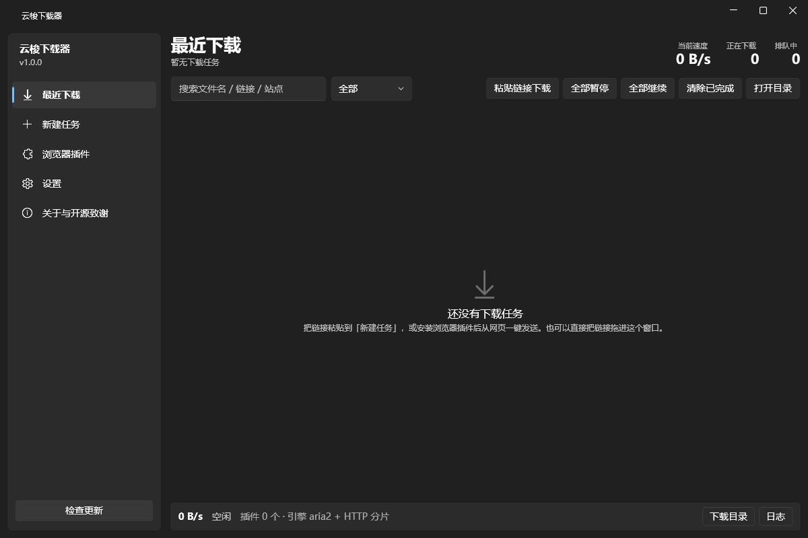
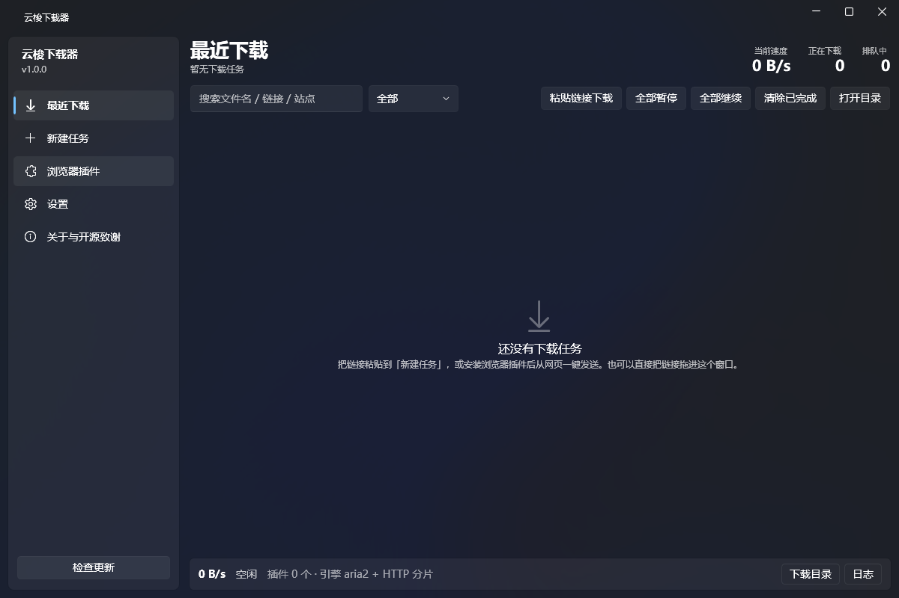
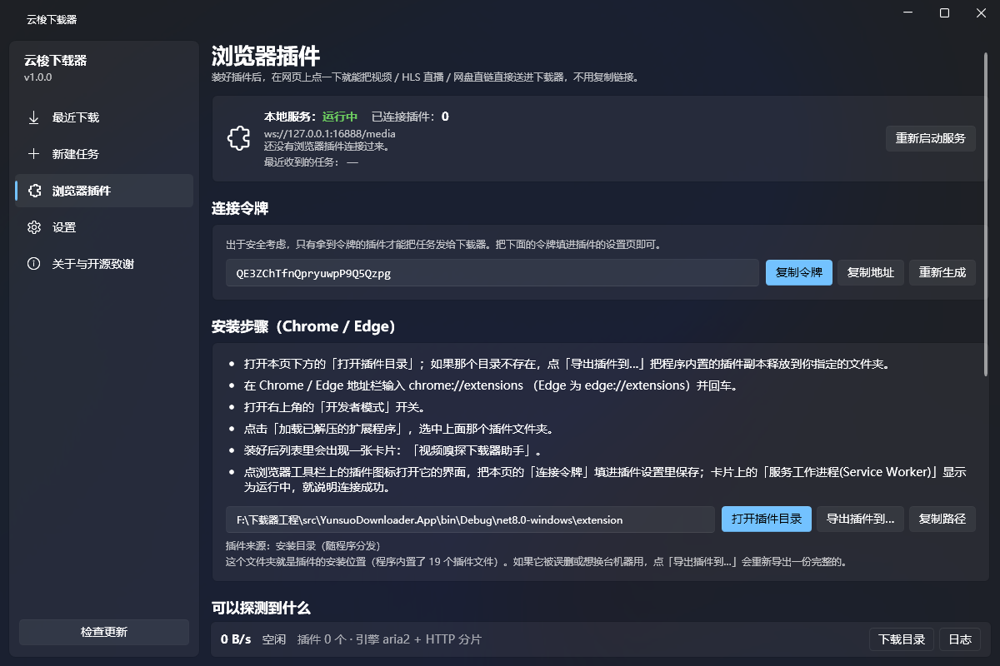
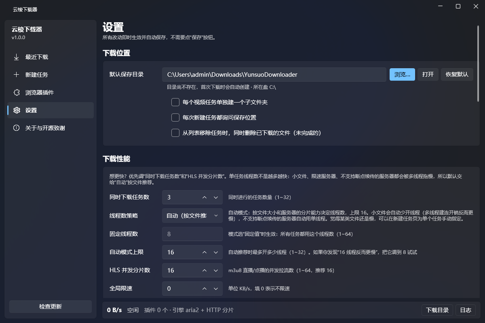
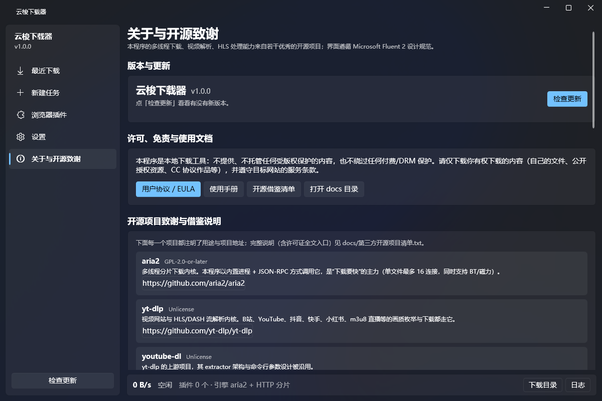

# 云梭下载器 · Yunsuo Downloader

> Windows 上的多线程下载器：**Fluent 2 界面 + aria2 多线程内核 + yt-dlp / ffmpeg 视频与 HLS 解析 + Chromium 浏览器插件联动**。
> 纯本地运行，无遥测、无广告、不经过任何第三方服务器。

[](https://github.com/zxcfdcopud/Yunsuo-downloader/releases)
[](#系统要求)
[](https://dotnet.microsoft.com/download)



---

## 功能

| 能力 | 说明 |
|---|---|
| **多线程分片下载** | 内置 aria2 内核；线程数默认**按文件大小和服务器能力自动推荐**（1~16），也可全局固定或按单个任务手动指定 |
| **视频网站解析** | B站 / YouTube / 抖音 / 快手 / 小红书 / 微博 / 优酷 / 爱奇艺 / 腾讯视频 / X / Instagram / TikTok 等（yt-dlp 提供，实际覆盖 1800+ 站点） |
| **HLS / DASH** | m3u8 / mpd 并发拉取分片，ffmpeg 自动合并为 MP4；支持直播流 |
| **磁力 / 种子 / 迅雷** | `magnet:`、`.torrent`、`thunder://` 直接粘 |
| **浏览器插件** | 一键嗅探网页里的视频、HLS 播放列表，点一下就送进下载器；自动带上 Cookie / Referer，会员内容与防盗链内容也能下 |
| **断点续传** | 暂停后继续；程序被关掉再打开也能接着下 |
| **下载时间可见** | 列表每行显示"下载时间"与已用时长 |
| **首次运行引导** | 四步向导：欢迎 → 下载位置 → 性能 → 浏览器插件 |
| **检查更新** | 走 GitHub Releases，有新版本会提示并可下载安装 |
| **Fluent 2 设计** | WPF-UI 提供 Mica 云母背景、圆角、系统标题栏一体化；图标字体在 Win10 / Win11 都正常显示 |

### 界面预览

| 新建任务 | 浏览器插件 |
|---|---|
|  |  |

| 设置 | 关于与开源致谢 |
|---|---|
|  |  |

---

## 系统要求

- **Windows 10 (x64) 或 Windows 11**
- **无需安装 .NET**：安装包是自包含的（自带 .NET 8 运行时）✅
- 约 500 MB 磁盘空间（含 ffmpeg / yt-dlp / aria2c 三个内核）

---

## 安装

1. 到 [Releases](https://github.com/zxcfdcopud/Yunsuo-downloader/releases) 下载最新的 `YunsuoDownloader-Setup-x.y.z.exe`
2. 双击安装（**按当前用户安装，不需要管理员权限，不会弹 UAC**）
3. 首次启动会走一遍四步引导

> 也可以直接下载便携版 zip 解压运行，不写注册表。

### 安装浏览器插件（推荐）

插件能把网页里的视频 / m3u8 直接送进下载器，省去复制链接。

1. 打开程序 →「浏览器插件」页 → 点「打开插件目录」拿到路径
2. 浏览器地址栏输入 `chrome://extensions`（Edge 用 `edge://extensions`）
3. 打开右上角「开发者模式」
4. 点「加载已解压的扩展程序」，选中那个 `extension` 文件夹
5. 列表里会出现卡片「**视频嗅探下载器助手**」
6. 点插件图标 → 把程序页里的「连接令牌」填进去 → 保存

> Chrome 137 起 `--load-extension` 命令行参数已被官方移除，只能走上面的界面方式加载。

---

## 从源码构建

需要 [.NET 8 SDK](https://dotnet.microsoft.com/download/dotnet/8.0)。

```powershell
# 构建
dotnet build YunsuoDownloader.sln -c Release

# 生成便携版到 artifacts\publish
powershell -ExecutionPolicy Bypass -File scripts\build.ps1 -SelfContained

# 生成安装包（需要 Inno Setup 6，脚本会自动按用户静默安装）
powershell -ExecutionPolicy Bypass -File scripts\build-installer.ps1
```

`tools\` 里的三个内核不在仓库里（体积大且是二进制）。首次构建会自动下载：

```powershell
powershell -ExecutionPolicy Bypass -File scripts\fetch-tools.ps1
```

### 目录结构

```
YunsuoDownloader.sln
src/
  YunsuoDownloader.App/      WPF 桌面程序（Fluent 2 界面）
  YunsuoDownloader.Core/     核心库：引擎 / 解析 / 设置 / 历史 / 插件服务 / 更新
  YunsuoDownloader.Cli/      命令行工具 ysd.exe（批量下载 + 离线端到端自检）
extension/                   Chromium MV3 浏览器插件（原生 JS，零第三方库）
                            ※ 同时作为内置副本编进 YunsuoDownloader.Core.dll，
                              发布后是 exe 同目录的 extension\，删掉也能一键导出
installer/                   Inno Setup 安装脚本
docs/                        用户协议 / 使用手册 / 开源清单 / 协议文档
scripts/                     构建、下载内核、自检脚本
```

---

## 命令行工具 `ysd.exe`

```powershell
ysd add "<链接>"                  # 添加并等待下载完成
ysd add "<链接>" --connections 2  # 指定本任务线程数
ysd probe "<链接>" --verbose      # 只解析，打印每一步请求
ysd list                          # 历史任务
ysd extension                     # 查看浏览器插件目录
ysd extension --export D:\my-ext  # 把内置插件副本导出到指定目录
ysd tools                         # 外部工具探测结果
ysd update                        # 检查更新
ysd selftest                      # 离线端到端自检（不联网）
```

`ysd selftest` 会在本地起 HTTP 服务，验证多连接分片、断点续传、aria2、HLS、插件协议等 80+ 项，
适合改完代码快速回归。

---

## 数据位置

| 内容 | 路径 |
|---|---|
| 设置 / 历史 / 日志 | `%APPDATA%\YunsuoDownloader` |
| 默认下载目录 | `%USERPROFILE%\Downloads\YunsuoDownloader` |
| 便携版数据 | 设置环境变量 `YSD_DATA_DIR` 可指定任意目录 |

卸载**不会**删除设置与已下载文件；需要清理时手动删掉上面那个 `%APPDATA%` 目录即可。

---

## 架构要点

```
浏览器插件 (MV3)                   桌面程序 (WPF)
  webRequest 三层嗅探                ┌─ 链接解析 (ILinkProvider 可插拔)
  MAIN world 拦截 fetch/XHR   ──ws──▶ ├─ 引擎选择：aria2 / 自研 HTTP / yt-dlp
  MSE 探测                          └─ 历史 + 统计 + 更新
```

- **引擎三选一**：aria2（最成熟、支持 BT）、自研 HTTP 分片引擎（没放 aria2c 时的兜底）、yt-dlp（视频/HLS）
- **插件 ↔ 程序**走本机 WebSocket（`127.0.0.1`，令牌鉴权），不经任何公网服务器
- 协议细节见 [docs/PROTOCOL.md](docs/PROTOCOL.md)

---

## 开源与致谢

本项目**大量依赖**以下优秀的开源项目，完整清单（含每一项的许可证与项目地址）见
**[docs/第三方开源项目清单.txt](docs/第三方开源项目清单.txt)**。

| 项目 | 用途 | 许可证 |
|---|---|---|
| [aria2](https://github.com/aria2/aria2) | 多线程下载内核（独立进程 + JSON-RPC 调用） | GPL-2.0-or-later |
| [yt-dlp](https://github.com/yt-dlp/yt-dlp) | 视频网站与 HLS 解析 | Unlicense |
| [FFmpeg](https://ffmpeg.org/) | 音视频合并、转封装 | LGPL/GPL |
| [WPF-UI](https://github.com/lepoco/wpfui) | Fluent 2 控件与 Mica 背景 | MIT |
| [CommunityToolkit.Mvvm](https://github.com/CommunityToolkit/dotnet) | MVVM 源生成器 | MIT |

> aria2 与 ffmpeg 是 GPL 系许可证。本程序只以**独立进程**方式调用它们，代码没有链接进本程序；
> 再分发本程序（含 `tools\`）时请一并附带它们的许可证文本与源码获取地址。

---

## 路线图

- [x] **v1.0** — 多线程下载、视频/HLS 解析、浏览器插件、断点续传、检查更新
- [ ] **v1.1** — 网盘分享链接解析（百度 / 阿里云盘 / 夸克 / 123，含提取码）

> 网盘解析代码已经写好并在内部测试，因接口兼容性还在最后验证，1.0 版本先不开放。
> 现在粘网盘链接会看到明确提示「网盘分享解析暂未开放」，不会误报成链接失效。

---

## 许可

本程序源代码采用 [MIT License](LICENSE)。
随包分发的 `tools\` 目录下的第三方程序（aria2 / yt-dlp / ffmpeg）各自遵循其原始许可证。

## 免责声明

本程序只是下载工具：不提供、不托管、不索引任何第三方内容，也不绕过付费墙、会员限制或 DRM。
请仅下载你有权下载的内容，并遵守目标网站的服务条款。使用本程序下载内容的合法性由使用者自行负责。
详见 [docs/EULA.txt](docs/EULA.txt)。
